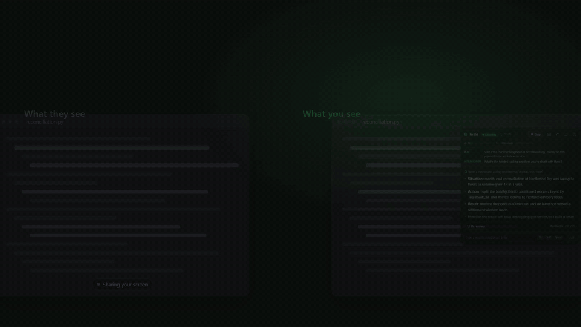
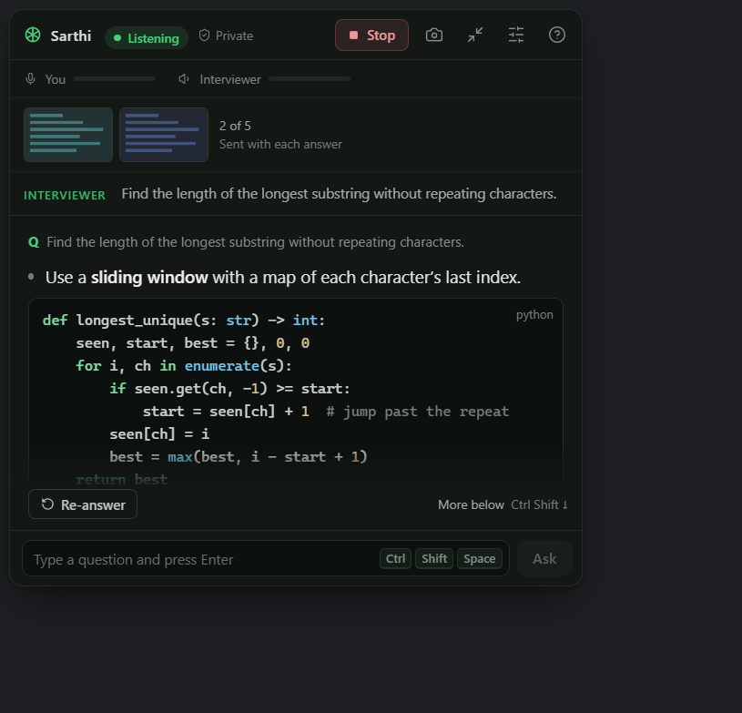
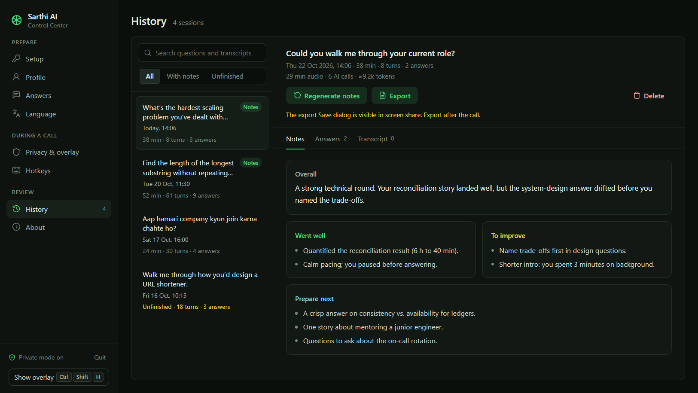
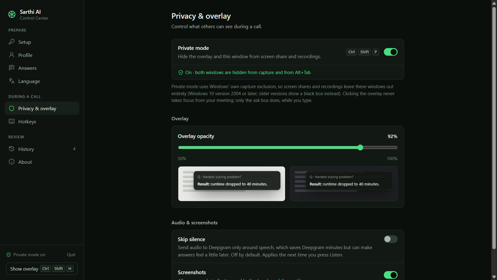

<div align="center">


# Sarthi AI

**A private, local-first interview copilot for Windows.**
It listens to the call, spots the interviewer's questions and streams a tailored answer into a small overlay
that screen sharing and recordings can't see.

[](https://github.com/positromen/Sarthi-AI/releases/latest)
[](https://github.com/positromen/Sarthi-AI/releases)
[](LICENSE)

[](https://github.com/positromen/Sarthi-AI/stargazers)

### [⬇ Download for Windows](https://github.com/positromen/Sarthi-AI/releases/latest) · free · open source · no account



<sub>21-second demo with sample data · <a href="docs/demo/sarthi-demo.mp4">watch it in full quality with sound</a></sub>

**If Sarthi is useful to you, a ⭐ helps other people find it.**

</div>

> *Sarthi* (सारथी) means charioteer: the one who guides quietly from beside you.

## Contents
- [Why Sarthi](#why-sarthi)
- [Features](#features)
- [How privacy works](#how-privacy-works)
- [Requirements](#requirements)
- [Getting started](#getting-started)
- [Using Sarthi](#using-sarthi)
- [FAQ](#faq)
- [Roadmap](#roadmap)
- [Development](#development)
- [Architecture](#architecture)
- [Contributing](#contributing)
- [Use responsibly](#use-responsibly)
- [License](#license)

## Why Sarthi
Most interview copilots are monthly subscriptions that route your call audio through their own servers. Sarthi is
different:

| | Sarthi |
|---|---|
| **Price** | Free. You bring your own keys, and Deepgram, Gemini and Groq all have free tiers. |
| **Your data** | Stays on your PC. No account, no server of ours, no telemetry. |
| **Privacy in a share** | Hidden by Windows itself, and verified with real screen captures. |
| **Source** | Open (MIT). Read every line that touches your audio and keys. |

## Features
- **Live transcript of both sides.** Your microphone and the call's audio are transcribed separately by Deepgram, so
  Sarthi knows who said what.
- **Answers as the question lands.** When the interviewer asks something, an answer streams in, grounded in your
  résumé, the job description and your notes. Behavioral questions follow STAR; coding questions get working code
  with complexity.
- **Screenshots for coding rounds.** Capture the problem on screen (up to five) and the answer reads it.
- **Type a question** when transcription misses one.
- **Your choice of model.** Gemini (default) and Groq have free tiers; Claude works with a paid Anthropic key. If one
  provider fails, the next takes over.
- **Languages.** Listen in English, Hindi or a mix, and answer in English, Hindi, Hinglish and more.
- **History and post-call notes.** Every session is saved on your PC with its transcript and answers, plus coaching
  notes on what went well and what to prepare next. Export any session as Markdown or PDF.
- **Usage meter.** See how much audio and how many AI tokens your own keys have used today and this month.
- **Global hotkeys** for everything, all rebindable.

<table>
  <tr>
    <td></td>
    <td></td>
  </tr>
</table>

## How privacy works
- **Hidden from screen share and recordings.** Private mode (on by default) asks Windows to exclude Sarthi's windows
  from every capture (`SetWindowDisplayAffinity` with `WDA_EXCLUDEFROMCAPTURE`). Screen-sharing and recording apps
  that capture through Windows leave them out, while you still see them.
- **No trace in the switcher.** In private mode the overlay and the Control Center stay off the taskbar, out of
  Alt+Tab, and the tray icon is hidden. Clicking the overlay never takes focus from your meeting.
- **Local-first.** No account, no server of ours, no telemetry. Your API keys are encrypted with Windows (DPAPI) and
  never leave the main process. Profile, history and logs stay in `%APPDATA%\sarthi-ai`.
- **What does leave your PC:** call audio goes to Deepgram, and questions with your profile go to the AI provider you
  choose, using your own keys.



**Limits to know:**
- Windows 10 version 2004 (build 19041) or later is required. Older builds capture protected windows as a black box,
  and Sarthi warns you if that's your case.
- Native Open and Save dialogs (profile upload, session export) are ordinary Windows windows that a share can see.
  Use them before or after a call.
- Nothing can hide a window from a camera pointed at your screen, or from software that captures the display's
  video signal outside Windows.

## Requirements
- Windows 10 version 2004 or later, or Windows 11.
- API keys. The first three have free tiers:
  | Service | Used for | Get a key |
  |---|---|---|
  | Deepgram | Live transcription | [console.deepgram.com](https://console.deepgram.com) |
  | Google Gemini | Answers (default) | [aistudio.google.com](https://aistudio.google.com) |
  | Groq | Fast answers | [console.groq.com](https://console.groq.com) |
  | Anthropic (optional) | Claude answers, paid | [console.anthropic.com](https://console.anthropic.com) |

## Getting started
1. Download **`Sarthi-AI-Setup-<version>.exe`** from the
   [latest release](https://github.com/positromen/Sarthi-AI/releases/latest) and run it. It installs for your
   Windows user only, with no admin prompt, and adds Sarthi AI to the Start menu.
2. The beta installer is not code-signed yet, so Windows SmartScreen may say "Windows protected your PC". Choose
   **More info → Run anyway**. Only install builds from this repository's Releases page.
3. On first launch a short setup guide asks for your keys, checks them with each provider and tests your microphone
   and system audio.

Sarthi updates itself: new versions download in the background and install the next time you quit it.

### Run from source
You need [Node.js](https://nodejs.org) 22 or newer.

```powershell
git clone https://github.com/positromen/Sarthi-AI.git
cd Sarthi-AI/app
npm install
npm run dev
```

## Using Sarthi
1. Fill in **Profile** (résumé, job description, notes). You can upload .pdf, .docx, .txt or .md.
2. Join your call, then press **Listen** (`Ctrl+Shift+L`).
3. Answers appear as the interviewer asks. Scroll with `Ctrl+Shift+↑/↓`, or drag the overlay by its header.
4. After the call, open **History** for the transcript, answers and coaching notes.

| Action | Default hotkey |
|---|---|
| Listen / stop | `Ctrl+Shift+L` |
| Answer now | `Ctrl+Shift+Enter` |
| Type a question | `Ctrl+Shift+Space` |
| Screenshot | `Ctrl+Shift+C` |
| Hide / show overlay | `Ctrl+Shift+H` |
| Control Center | `Ctrl+Shift+S` |
| Private mode | `Ctrl+Shift+P` |
| Move overlay | `Ctrl+Alt+Arrows` |

All except scroll and move can be changed under **Hotkeys**.

## FAQ
**Is it really invisible in a screen share?**
Yes, on Windows 10 version 2004 and later. Windows itself leaves Sarthi's windows out of captures. We tested this by
capturing the screen through the classic GDI path and through Chromium's screen capture (the path browser-based
meeting apps use): with private mode on, both captures show no Sarthi; with it off, both show it. See
[How privacy works](#how-privacy-works) for the limits.

**Does it cost anything?**
No. Sarthi is free and open source. It uses your own API keys, and the free tiers of Deepgram, Gemini and Groq are
enough to get started. The usage meter shows what your keys have used.

**Does my audio go to a Sarthi server?**
No. There is no Sarthi server. Audio goes straight from your PC to Deepgram, and questions go to the AI provider you
pick, using your keys.

**Which answer provider should I use?**
Groq answers in about a second. Gemini's free tier can take longer to start. Claude needs a paid Anthropic key. If
one provider fails, Sarthi tries the next.

**macOS or Linux?**
Not yet. Sarthi relies on Windows' capture exclusion today. See the [roadmap](#roadmap).

**Why does Windows warn me when I install it?**
The beta installer isn't code-signed yet, so SmartScreen doesn't know it. Choose **More info → Run anyway**, and only
download from this repository's Releases page.

## Roadmap
- Answer bank: prepare answers before the call so they appear instantly
- Practice mode: Sarthi asks, you answer, and the notes grade you
- Smaller installer
- Code-signed installer
- macOS support

Have an idea or found a bug? [Open an issue](https://github.com/positromen/Sarthi-AI/issues/new/choose).

## Development
All commands run in `app/`:

| Command | What it does |
|---|---|
| `npm run dev` | Starts the app with hot reload for the windows. Main/preload changes restart the app. |
| `npm run build` | Builds into `app/out/`. |
| `npm run typecheck` | Type-checks every process with one `tsconfig.json`. |
| `npm test` | Runs the Vitest suite. One test: `npx vitest run <file> -t "<name>"`. |

If the app fails to start with `app` undefined, your shell has `ELECTRON_RUN_AS_NODE=1` set (some editors do this).
Clear it first: `Remove-Item Env:ELECTRON_RUN_AS_NODE`.

## Architecture
Sarthi is an Electron app with three processes that share types and IPC channel names from `app/src/shared/`.

```
app/src/
├─ main/       Owns all state, secrets and network: windows, hotkeys, encrypted keys, Deepgram,
│              the AI providers (gemini.ts, groq.ts, anthropic.ts behind llm.ts), history, usage, logs
├─ preload/    The only bridge: exposes a typed window.sarthi API to the windows
├─ renderer/   React UI: the overlay and the Control Center (settings, history, onboarding)
└─ shared/     Types, IPC names and pure logic used by both sides
```

- **Audio:** the overlay captures the mic and system audio, sends 2-channel 16 kHz frames to main, and main streams
  them to Deepgram (channel 0 is you, channel 1 is the interviewer).
- **Answers:** when the interviewer's turn looks like a question, main builds a prompt from your profile and the recent
  transcript, and streams the answer from the chosen provider back to the overlay.
- **Security:** API keys and network calls live only in main. Windows talk to main through the preload bridge, and
  every renderer request is validated there.

## Contributing
Contributions are welcome. Read [CONTRIBUTING.md](CONTRIBUTING.md) for setup, conventions and the pull request
checklist, and please follow the [Code of Conduct](CODE_OF_CONDUCT.md). To report a security problem privately, see
[SECURITY.md](SECURITY.md).

## Use responsibly
Sarthi is a preparation and support tool. Some interviews, exams and employers forbid outside help, so check the rules
of yours before using it in a live session. You're responsible for how you use it.

## License
[MIT](LICENSE) © 2026 Siddhesh Sakle
